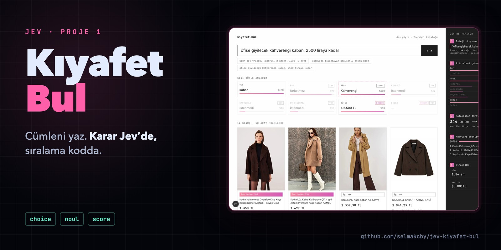

# jev-kiyafet-bul



Doğal dille dış giyim arama. Kullanıcı ne aradığını yazar ("uzun bej trench, kemerli, M beden, 3000 TL altı");
Jev (TypeSafe System One) iki adımda karar verir, kod filtreler ve sıralar, sonuçlar kart olarak gelir.
Sağdaki koyu panel her aramada adım adım "Jev ne yapıyor" akışını gerçek veriyle gösterir.

- Video: YAKINDA
- Sunum: https://www.selma.codes/blog/jev
- Diğer Jev projeleri: [jev-kiyafet-bul](https://github.com/selmakcby/jev-kiyafet-bul) · [jev-canli-yargic](https://github.com/selmakcby/jev-canli-yargic) · [jev-minecraft-bot](https://github.com/selmakcby/jev-minecraft-bot)

## Jev nedir

Jev metin üretmez. Ona bir durum (`state`) ve tipli sorular verirsin, her soruya **olasılık** döner:

| Soru tipi | Ne döner | Örnek |
|---|---|---|
| `Choice` | Seçeneklerin olasılık dağılımı + seçilen + güven | "Bu cümle: öğretiyor / dolgu / tekrar?" |
| `Noul` | Bir önermenin doğru olma olasılığı (0–1) | "Bu cümle kurguda kesilmeli." |
| `Score` | Sıralı seviyelere dağılım + ağırlıklı ondalık skor | "Uyum: Alakasız / Kısmen / İyi / Tam isabet" |

Bütün sorular tek çağrıda, birbirinden bağımsız cevaplanır. Çıktı token'ı yok, bu yüzden hızlı (videodaki
ölçümlerde medyan ~300 ms) ve ucuz.

- Doküman: https://docs.typesafe.ai
- Sınırları (neyi iyi, neyi kötü yapıyor): https://docs.typesafe.ai/model-jaggedness/jev-1.13
- Eğitim yöntemi: RLCD, "Reinforcement Learning for Calibrated Decisions". Amaç, söylediği yüzdenin
  gerçekleşme oranına denk gelmesi (kalibrasyon).
- Mimari açıklanmadı. İçeride ne döndüğüne dair videoda ve bu repoda söylenen her şey tahmindir.

**Genel kural:** karar ve yüzde lazımsa Jev, cümle lazımsa LLM, sayı/hesap/tarih lazımsa kod.
Bu proje bu ayrımla kuruldu: Jev karar verir, kod uygular.

## Anahtar almak

İki yol var, ikisi de aynı modele gider:

1. **TypeSafe konsolu**: https://docs.typesafe.ai üzerinden bekleme listesine yazıl; anahtar `TYPESAFE_API_KEY`.
2. **Vercel AI Gateway**: model adı `typesafe-ai/jev`; anahtar `AI_GATEWAY_API_KEY`.

Fiyat: girdi 0,042 USD / milyon token, çıktı ücretsiz.

```bash
cp .env.example .env   # anahtarını yaz; .env git'e girmez
```

Anahtar yoksa proje **sahte Jev** ile çalışır (deterministik, anlamsız ama şekli doğru cevaplar; panellerde
"SAHTE" rozeti). `JEV_SAHTE=1` anahtar olsa bile sahteyi zorlar. Testlerin hepsi sahte Jev ile koşar.

## Nasıl çalışır

| Adım | Kim | Ne |
|---|---|---|
| 1. İsteği oku | Jev, tek çağrı | `kapsam` (dış giyim / kazak-hırka / katalog dışı), `tur`, `uzunluk`, `renk` (Choice) + `kemerli`, `kapusonlu`, `su_gecirmez`, `butce_var` (Noul). State = kullanıcı metni. |
| — | Kod (regex) | Fiyat üst sınırı ve beden. Jev sayı okumaz; `butce_var` sadece "sınır var mı" der, sayıyı regex çıkarır. |
| — | Kod | Kapsam kapısı: `katalog_disi` güveni ≥ 0,5 ise puanlamaya geçilmez; 200 + boş sonuç + "Bu katalogda sadece dış giyim ve kazak var; '…' kapsam dışı." Panelde Adım 3–5 "atlandı". |
| 2. Filtre | Kod | Güveni 0,5 altındaki filtre uygulanmaz ("atlandı"). Boy filtresi kazak kategorisine uygulanmaz. |
| 3. Daralt | Kod | Katalog filtrelenir, en fazla 60 aday. Tam eşleşen 12'den azsa en az güvenli filtre "esnek" olur; tam eşleşenler yine en önde. |
| 4. Puanla | Jev, aday başına bir çağrı | `uyum` Score (Alakasız/Kısmen/İyi/Tam isabet) + `neden_uymuyor` Choice. 10'arlı partiler halinde `Promise.all`. |
| 5. Sırala | Kod | `skor (0–1) × güven`; ilk 12 ürün. Kartta en olası seviye ve olasılığı ("Tam isabet %78"). |

Kod yerleri: `lib/filtre.ts` (Adım 1), `lib/regex.ts`, `lib/daralt.ts`, `lib/sirala.ts` (Adım 2 + sıralama), `lib/ara.ts` (hat),
`lib/jev.ts` (istemci), `lib/kota.ts`, `app/api/ara/route.ts`, `components/` (arayüz).

## Komutlar

```bash
npm install
npm run dev          # http://localhost:3000
npm test             # vitest (sahte Jev ile)
npm run lint
npm run build
npm run katalog:ham  # Apify'dan ham veri → data/ham.json (ücretli, bir kere)
npm run katalog      # data/ham.json → data/katalog.json
```

## Ortam değişkenleri

Hepsi sunucu tarafında okunur; istemciye gitmez. Yerelde `cp .env.example .env.local` yapıp doldur (Next.js okur);
`lib/env.ts` ayrıca `~/.env` dosyasına da bakar. Vercel'de proje ayarlarından girilir. Anahtar yoksa uygulama sahte Jev ile açılır.

| Değişken | Ne |
|---|---|
| `TYPESAFE_API_KEY` | Varsa Jev'e doğrudan TypeSafe API'si üzerinden gidilir. |
| `AI_GATEWAY_API_KEY` | `TYPESAFE_API_KEY` yoksa Vercel AI Gateway üzerinden. |
| `JEV_SAHTE=1` | Anahtar olsa bile deterministik sahte Jev (geliştirme/test). İki anahtar da yoksa otomatik sahte. |
| `GUNLUK_TAVAN` | Günlük toplam arama tavanı (varsayılan 300). |
| `APIFY_TOKEN` | Sadece katalog betiği için. |

API cevabında model ya da sağlayıcı adı yer almaz. Sunucu günlüğü (stdout, JSON satırı) sadece token, süre ve
çağrı sayısını yazar; kullanıcı metni ve anahtar yazılmaz.

## API

`POST /api/ara` gövde `{ "metin": "..." }` (3–300 karakter, Zod).
Cevap zarfı `{ success, data, error }`; `data`: `filtreler`, `sonuclar` (en fazla 12), `katalogBoyutu`, `adaySayisi`,
`cagri`, `token`, `maliyetUsd` (0,042 USD / milyon girdi token), `sureMs`, `ornekMod`, `kapsamDisi`, `mesaj` (kapsam dışıysa açıklama, değilse null).
`Accept: text/event-stream` gönderilirse aynı hat SSE olarak akar: her adım için `event: adim`, en sonda
`event: sonuc` (içinde aynı zarf). Arayüz bu modu kullanır.

## Kota

- IP başına dakikada 10 arama → 429 "Çok hızlı arıyorsun…"
- Günlük toplam `GUNLUK_TAVAN` (varsayılan 300) → 429 "Bugünlük kota bitti, yarın yine gel"
- Geçersiz istek (400) kotaya sayılmaz.
- Sayaç bellek içi. Vercel'de her fonksiyon örneğinin kendi belleği var ve soğuk başlangıçta sıfırlanır; gerçek bir
  tavan için sayacı Vercel KV / Upstash Redis'e taşı (`lib/kota.ts` tek dosya).

## Katalog ve hak notu

- Kaynak: Trendyol, Apify actor `fatihtahta/trendyol-scraper` (pay-per-event, ürün başı ~0,0009 USD).
  Sorgular: kadın trençkot / trenchcoat, kaban, mont, ceket, kazak, hırka. Videodaki katalog 561 üründü
  (ceket 63, mont 98, trençkot 112, kaban 88, kazak 100, hırka 100); 10 koşu, toplam ~0,63 USD.
- **Repoda sadece 20 ürünlük örnek** (`data/katalog.json`) var; uygulama bununla açılır. Tam katalog kazınmış veri
  olduğu için paylaşılmıyor. Kendin çekmek için: `APIFY_TOKEN`'ı `.env.local`'a yaz, sonra
  `npm run katalog:ham` (ücretli, ~0,6 USD, `data/ham.json`) ve `npm run katalog` (örneğin üzerine yazar).
- Ürün görselleri **katalogdaki `gorsel_url`'den** gelir (Trendyol CDN, hotlink). Google görsel araması ya da
  başka bir görsel kaynağı kullanılmaz. Görsellerin ve ürün metinlerinin hakları Trendyol'a ve satıcılara aittir;
  bu uygulama demo amaçlıdır, her kart ürünün Trendyol sayfasına link verir. Yayında kalacaksa görsel kullanımı
  için izin ya da affiliate/partner API gerekir.
- `data/ham.json` git'e girmez (büyük, satıcı iletişim bilgisi içerir).

## Vercel'e deploy

1. Vercel'de yeni proje → bu repo, **Root Directory: `kiyafet-bul`**, framework Next.js.
2. Environment Variables: `TYPESAFE_API_KEY` (ya da `AI_GATEWAY_API_KEY`), isteğe bağlı `GUNLUK_TAVAN`.
3. Deploy. `data/katalog.json` derlemeye gömülüdür; ek depolama gerekmez.

## Bilinen eksikler / v2

- Blazer: Apify actor'ı "blazer" sorgularında 0 ürün döndü; katalogda blazer yok (Jev yine "blazer" seçebilir,
  o zaman tür filtresi esnek olur).
- Beden: liste verisi sadece tek bir varyantın bedenini veriyor; stok listesi yok. Beden regex ile anlaşılır ve
  gösterilir ama ürün elemez (bedeni bilinmeyen ürün elenmez).
- Boy bilgisi 184 üründe "Standart/Regular" ya da yok; bu ürünler boy filtresinde elenmez, Jev puanlar.
- Fotoğraf yükleme yok (v2: fotoğraftan benzer ürün).
- Kota sayacı bellek içi (yukarıya bak).

## Lisans

Tüm hakları saklıdır. Kodu okuyup öğrenmek için kendi bilgisayarında çalıştırabilirsin; kopyalayıp yayınlamak, değiştirip dağıtmak ya da ticari kullanmak için izin gerekir. Ayrıntı: [LICENSE](LICENSE).
